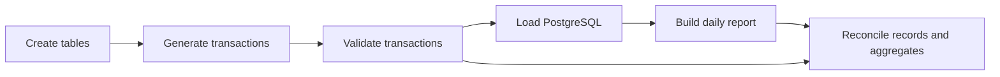

# Transaction reporting with Apache Airflow and PostgreSQL

A small, tested data-engineering portfolio project using synthetic payment data.
Built by Yi Wang with OpenAI Codex assistance. This is a personal project, not an
Apache Software Foundation or Revolut product.

## Standalone deployment and recovery lab (12 October 2026)

A pinned Docker Compose deployment now runs independently of the Airflow source
checkout. It includes file-backed secrets, separate database roles, a loopback-only
UI, health checks, real DAG integration checks, and an isolated restore drill.
See [deployment instructions](docs/DEPLOYMENT_LAB.md) and
[local verification](evidence/deployment-20261012/VALIDATION.md).
GitHub workflows are prepared; cloud deployment and GitHub execution are not claimed.

## Pipeline



The manual Dag generates 200 deterministic transactions for a selected UTC date,
validates every record, loads PostgreSQL, aggregates completed payments by currency,
and independently reconciles persisted records and aggregates.

## Engineering choices

- Python TaskFlow API and SQLExecuteQueryOperator; PostgreSQL provider connection `payments_db`.
- Integer cents for input money; Decimal for independent aggregate checks.
- Deterministic UUIDs, a primary key, and `ON CONFLICT DO NOTHING` for replay-safe loading.
- Atomic report rebuilding for one date; explicit UTC boundaries and separate currencies.
- Validation of IDs, field sets, amounts, timestamps, currencies, and payment status.
- SQL parameters for input values; load failures roll back their transaction.
- Exact reconciliation catches conflicting immutable records on replay.
- Manual schedule and `max_active_runs=1` keep this exercise's runs serialized.

## Verified results

Recorded on 2026-10-01 using Python 3.12, an Airflow source checkout, Breeze, and PostgreSQL.
These are saved local results, not GitHub Actions results.

| Scenario | Observed result |
|---|---|
| Unit tests | 22 passed |
| Baseline | All six tasks succeeded; 200 rows and 200 distinct IDs |
| Daily report | Three currency groups: AUD, EUR, USD |
| Replay | All six tasks succeeded; database snapshot unchanged |
| Invalid negative amount | Validation failed; load/report/quality tasks did not execute |
| Failure isolation | Database snapshot unchanged |

See [verification results](evidence/step3-verification.json),
[test output](evidence/transaction-tests.log), and the saved
[baseline](evidence/payments-baseline-db.json),
[replay](evidence/payments-replay-db.json), and
[rejected-input](evidence/payments-invalid-db.json) database snapshots.
All transaction data is synthetic.

## Run in an Airflow development environment

The original Breeze procedure below is retained for historical reproduction.
For the standalone deployment, use the deployment lab above.
The demo was verified in the Apache Airflow development checkout. The related
contribution branch now points to `14d9ef2c4703b9649a132c558b89ca260a17023f` on
[the contribution branch](https://github.com/yi-wang-ai/airflow/tree/fix-72929-clear-task-state).
Follow the checkout's Breeze setup instructions. The local ARM64 image required a
MariaDB packaging workaround, so a clean standard-image build has not been verified.

From this repository, copy the source into an existing checkout's ignored `files` directory:

```bash
export AIRFLOW_CHECKOUT=/path/to/airflow
mkdir -p "$AIRFLOW_CHECKOUT/files/dags" "$AIRFLOW_CHECKOUT/files/tests"
cp dags/transaction_reporting.py "$AIRFLOW_CHECKOUT/files/dags/"
cp tests/test_transaction_reporting.py "$AIRFLOW_CHECKOUT/files/tests/"
cd "$AIRFLOW_CHECKOUT"
breeze start-airflow --python 3.12 --backend postgres --answer yes
```

In the Airflow UI, configure a PostgreSQL connection named `payments_db` with your
local database host, port, database, user, and password. The database user needs
permission to create the `payment_demo` schema and tables. For the verified Breeze
network, the host was `postgres`, port `5432`, and database `airflow`.
Enter credentials locally; do not commit them. Both PostgreSQL and common-SQL
providers must be installed in the Airflow environment.

1. Unpause `transaction_reporting` and trigger with `report_date` set to `2026-10-01`
   and `transactions` set to null.
2. Check the six task states and `quality_check` log.
3. Trigger the same parameters again and compare database snapshots.
4. Trigger using the `conf` object in [the invalid-input fixture](payments-invalid-request.json).
   Its reporting date is `2026-10-02`. Expect validation failure and no data changes.
5. Run [verify-payments.sql](verify-payments.sql) against the configured database before
   and after each run to compare row counts and complete-table digests.

Run the pure-function tests inside Breeze:

```bash
breeze run --backend sqlite --python 3.12 --skip-image-upgrade-check \
  pytest -c /dev/null --confcutdir=/files/tests /files/tests/test_transaction_reporting.py -q
```

These unit tests do not exercise PostgreSQL. The saved baseline, replay, and invalid-input
runs provide the integration evidence. `breeze run` starts an isolated environment;
its database is separate from an already running UI environment.

## Related upstream contribution

[Apache Airflow PR #74001](https://github.com/apache/airflow/pull/74001)
addresses [issue #72929](https://github.com/apache/airflow/issues/72929): discard task
checkpoints consistently when clearing tasks, with an explicit preservation option.

Implementation and push are complete: shared Python clear logic, REST API, CLI,
single/bulk UI options, regression tests, documentation, and numbered newsfragment.
Local validation recorded 1,057 passing backend tests and another suite of 335 passing
tests (the suites overlap), plus nine UI tests, lint, type checking, and UI build.

As checked through GitHub on 2026-10-12, the PR is **closed, unmerged**.
The local validation above is historical evidence and does not imply upstream
acceptance. The standalone deployment lab is separate from that contribution.

The portfolio Dag is separate from the upstream patch and is not included in that PR.

## Scope and limitations

This is a batch reporting exercise, not a payment processor. It does not implement
an API service, Kafka, fraud detection, payment corrections, or a production
deployment. The teaching deployment adds Airflow UI authentication. Transactions are immutable; conflicting updates are detected
by reconciliation, not applied. Small batches travel through XCom; a larger system
would use external storage references. The 22 unit tests cover pure functions;
PostgreSQL scenarios were verified through manual Dag runs.

Code was prepared with generative-AI assistance and reviewed through the recorded
checks. The upstream PR contains its own Gen-AI disclosure. Apache license and notice
files accompany the source headers.
